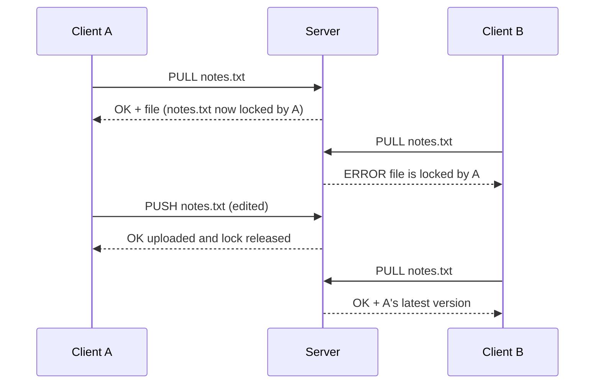

# FileSync — Client-Server File Synchronization in C

A TCP client-server system that lets multiple clients share files through a central server, with **file locking so two people can never overwrite each other's edits**. Built from scratch in C using POSIX sockets.

`C` · `TCP/IP sockets` · `POSIX` · `File I/O` · `Make` · `SHA-256 verification` · `Fault injection testing`

---

## Highlights

- **Verified integrity:** 1 MiB, 10 MiB and 100 MiB binary files transfer byte-for-byte, confirmed with SHA-256 checksums.
- **Fast:** ~453 MiB/s download and ~416 MiB/s upload for 100 MiB files (localhost, 10-run average).
- **Found and fixed a silent data-corruption bug:** under a simulated slow network, **60/60 downloads were corrupted before the fix and 0/60 after.**
- **Patched a security hole:** blocked a path-traversal attack that could read or write files outside the server's folder.

---

## How It Works

When a client **pulls** a file, the server sends it and **locks** it for that client. Nobody else can pull or overwrite it until the owner **pushes** the updated version back or sends **done**.



| Command | What it does |
|---|---|
| `pull <file>` | Download a file and lock it for yourself |
| `push <file>` | Upload a new file, or an updated file you hold the lock on (releases the lock) |
| `status` | List every server file with its size, lock state and lock owner |
| `done` | Release all locks you hold without uploading |

Under the hood, client and server talk over a small text protocol (`PULL <id> <file>`, `PUSH <id> <file> <size>`, ...) with newline-terminated headers, followed by binary file data streamed in 1 KiB chunks.

---

## My Role

FileSync was built by a team of three for **CS 551: Systems Programming at Binghamton University** (Feb–May 2026).

**What I built:**
- The **client**: TCP connection setup (IPv4/IPv6), all four commands, input validation, chunked upload/download, and error handling
- Part of the **client-server connection** logic, plus most of the project report

**What I did after the course:**
- Designed and ran **integrity and performance tests** (SHA-256, 1–100 MiB files, repeated timed trials)
- **Found, reproduced and fixed** an intermittent download-corruption bug using fault injection
- **Patched a path-traversal vulnerability** in the server and verified it with raw-socket attack tests

**Teammates:** Dorin Flocos (server architecture and request handling) and Max Argenson (metadata, file locking and lock ownership).

This is my portfolio copy. The original team repository, with full commit history, is at [dfl0/filesync](https://github.com/dfl0/filesync); my commits there are under [Rucha414](https://github.com/Rucha414).

---

## Quick Start

Requires GCC or Clang, Make, and macOS or Linux.

```bash
make                 # build ./server and ./client
./server 8080        # terminal 1: start the server
```

```bash
# terminal 2: run client commands
./client 127.0.0.1 8080 client1 status
./client 127.0.0.1 8080 client1 pull notes.txt
./client 127.0.0.1 8080 client1 push notes.txt
./client 127.0.0.1 8080 client1 done
```

Format: `./client <server_ip> <port> <client_id> <command> [filename]`. The server stores files in `server_files/`; the client reads and writes `client_files/`.

### Try the lock in action

```bash
./client 127.0.0.1 8080 client1 pull notes.txt    # client1 takes the lock
./client 127.0.0.1 8080 client2 pull notes.txt    # → ERROR file is locked by client1
./client 127.0.0.1 8080 client1 done              # → OK released 1 lock(s) for client client1
./client 127.0.0.1 8080 client2 pull notes.txt    # → works now
```

---

## Testing & Results

Full methodology, raw numbers and reproduction steps are in **[TEST_RESULTS.md](TEST_RESULTS.md)**.

### Integrity

| File size | Upload (SHA-256) | Download (SHA-256) |
|---|---|---|
| 1 MiB | ✅ Match | ✅ Match |
| 10 MiB | ✅ Match | ✅ Match |
| 100 MiB | ✅ Match | ✅ Match |

### Performance (100 MiB file, 10 runs, localhost on an M2 MacBook Pro)

| | Download (PULL) | Upload (PUSH) |
|---|---:|---:|
| Average time | 0.221 s | 0.241 s |
| Throughput | **453.3 MiB/s** | **415.6 MiB/s** |

These are application-level localhost numbers, not real network bandwidth.

### Bug fix: silent download corruption

**Problem:** The server sent its `OK <size>` header and the file data back-to-back with no delimiter. The client read up to 1 KiB for the header, sometimes swallowing the first part of the file, and still printed "Download complete."

**Why it hid:** On a fast local machine the header usually arrived alone, so normal tests passed.

**How I proved it:** I injected a 200 ms delay before the client read the header to simulate a slow network.

| | 1 MiB | 10 MiB | 100 MiB |
|---|---|---|---|
| Before fix | 20/20 corrupted | 20/20 corrupted | 20/20 corrupted |
| After fix | 0/20 corrupted | 0/20 corrupted | 0/20 corrupted |

**Fix:** newline-terminated headers, a client that reads exactly up to the newline, and real error checks so failures are reported instead of hidden.

### Security fix: path traversal

A raw request for `../../secret_test.txt` made the server return a file **outside** its folder. The server now validates every filename on PULL and PUSH, and both read and write attacks return `ERROR invalid filename`.

---

## Known Limitations

- The server handles one connection at a time.
- Locks are kept in memory: they reset on restart and never expire on their own.
- Client IDs are not authenticated.

The complete list is in [TEST_RESULTS.md](TEST_RESULTS.md#6-limitations).

---

## Project Structure

```text
filesync-client-server/
├── client.c             # Client: commands, connection, upload/download
├── server.c             # Server: request handling, locking, metadata, filename validation
├── common.h             # Shared socket and file-transfer helpers
├── Makefile
├── TEST_RESULTS.md      # Test methodology, benchmarks, bug and security fixes
├── file_sync_report.txt # Original course report
├── client_files/        # Client's local folder
└── server_files/        # Server's storage folder
```